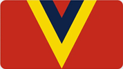

# Visual specifications

## State flags

Original PNGs: **178 × 100 px** each.

| State | Code | File |
|---|---|---|
| South Australia | SA | `state-flags/sa.png` |
| Western Australia | WA | `state-flags/wa.png` |
| Vic Metro | VM | `state-flags/vm.png` |
| Vic Country | VC | `state-flags/vc.png` |
| Allies | AL | `state-flags/al.png` |

Display: **32 × 18 px desktop**, **30 × 17 px mobile**. Radius: **4 px**. Shadow: `0 1px 2px rgba(25,33,31,.16)`.

```html

```

```css
.state-flag {
  width:32px; height:18px; flex:none; object-fit:cover;
  display:block; border-radius:4px;
  box-shadow:0 1px 2px rgba(25,33,31,.16);
}
@media (max-width:720px) {
  .state-flag { width:30px; height:17px; }
}
```

Flags occupy a centred column between rank and prospect.

## Club badges

Two adjacent sections: coloured club code + neutral relationship label. **NGA / Academy → A**; **Father-son → FS**.

```html
<span class="club-badge" title="Port Adelaide NGA">
  <span class="club-code" style="background:#008aab;color:#fff">PTA</span>
  <span class="club-type">A</span>
</span>
```

| Club | Display code | Background | Text |
|---|---|---|---|
| Port Adelaide | PTA | #008aab | #ffffff |
| Carlton | CAR | #071a38 | #ffffff |
| Hawthorn | HAW | #4d2008 | #f3b72b |
| Brisbane Lions | BRI | #751936 | #f4c800 |
| North Melbourne | NTH | #095aa6 | #ffffff |
| Sydney Swans | SYD | #d71920 | #ffffff |
| West Coast | WCE | #003b78 | #f4c430 |
| Fremantle | FRE | #4e2683 | #ffffff |
| Richmond | RIC | #151515 | #ffd200 |
| Essendon | ESS | #171717 | #ffffff |
| Western Bulldogs | WBD | #1557a4 | #ffffff |
| Adelaide | ADE | #002b5c | #f1c400 |
| Gold Coast Suns | GCS | #d71920 | #ffd300 |
| GWS Giants | GWS | #c84e00 | #ffffff |

Essendon club block: additional `box-shadow:inset 0 -3px #d71920`.

| Dimension | Desktop | Mobile ≤720px |
|---|---|---|
| Capsule minimum height | 26px | 20px |
| Club block | min-width 31px; height 25px; padding 0 6px | width 31px; height 19px; no padding |
| Relationship block | padding 0 8px | width 24px; height 19px; no padding |
| Relationship font | .61rem / 600 | .52rem / 600 |
| Club-code font | .54rem / 500 | .5rem / 500 |
| Gap between badges | 6px | 4px |

Capsule: `inline-flex; align-items:center; overflow:hidden; padding:0; box-sizing:border-box; border:1px solid #bbb9b1; border-radius:4px; background:rgba(255,255,255,.64); color:#3f4745`.

Badge font: `Arial, Helvetica, sans-serif`; line-height `1`; uppercase; nowrap. Letter spacing: `.035em` relationship, `.045em` club code. Text centred in each block. Desktop name-to-badge gap: **32px**. Mobile: right-aligned on the name line; A and FS blocks have identical dimensions.

Compact variant (≤680px mobile breakpoint): desktop capsule 23px, club block min-width 29px / height 22px / padding 0 5px, relationship padding 0 7px; mobile capsule 19px, club block 31 × 18px, relationship 24 × 18px. Font sizes: relationship .55rem desktop / .49rem mobile; club code .49rem. Badge gap 5px. Border #bcbab3; background rgba(255,255,255,.6); text #3e4543.

## Prospect-name typography

```css
font-family:Inter, ui-sans-serif, -apple-system,
            BlinkMacSystemFont, "Segoe UI", sans-serif;
```

| Variant | Desktop | Mobile | Weight | Line height | Colour | Hover |
|---|---|---|---|---|---|---|
| Standard | .98rem | .93rem (≤720px) | 720 | 1.25 | #1e2424 | #ae432d |
| Compact | .98rem | .92rem (≤680px) | 740 | 1.25 | #19211f | #c64d2e |

At a 16px root: .98rem = 15.68px; .93rem = 14.88px; .92rem = 14.72px. No underline. Mobile: nowrap with ellipsis.

Inter is not supplied as a font file; rendering uses the first available font in the stack.
